# zos: a homebrew OS for ATJ2085 ("s1mp3") MP3 players

zos is a small OS written from scratch for MP3/MP4 players built around the Actions Semiconductor
**ATJ2085(X)**: a Z80-compatible MCU with a 24-bit audio DSP, the chip family that the s1mp3
community calls "s1mp3". zos does not reuse the stock ACTOS code. It has its own interrupt
handler, timer, key scan, LCD driver, NAND/FTL driver, FAT file system, module loader, USB stack
and UI. It is written in C and Z80 assembly (SDCC). Apps are `.ZM` modules that you copy to the
player's USB disk.

<p>
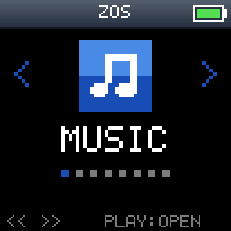
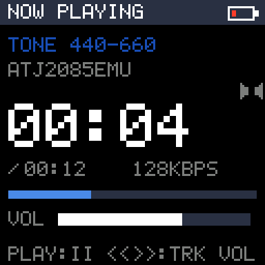
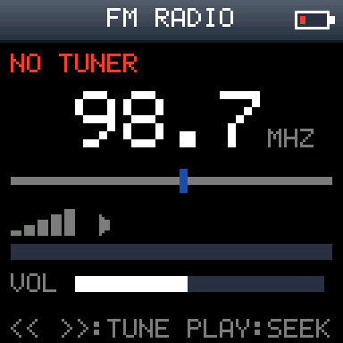
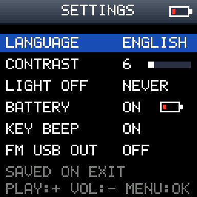
</p>

The repository also contains **atj2085emu**, a Python emulator of the player that runs the
real boot ROM, firmware and NAND from your own dump, plus the tools used to build, inject, boot
zos, and the hardware research notes behind all of it.

> **Status: experimental.** zos runs on my own device (a Ximpro-branded LISONG LSD_501 board).
> Most features were developed in the emulator first and then tried on the device; some are
> emulator-verified only (marked below). Expect bugs, and read [Safety](#safety-read-this-first)
> before you flash anything.

## Features

| Area | What works | Verified on |
|---|---|---|
| Core | own IM1 ISR, 10 ms tick, debounced keys with repeat and long press, event loop with `HALT` idle, watchdog | device |
| Display | direct LCD controller driver (SSD1789-compatible, 128x128 RGB565), unrolled fills, asm glyph streaming, DMA blits | device |
| Storage | own NAND + stock-compatible "641" FTL (writes limited to the user disk, plus FWIMAGE copy A for the FIRMWARE update), own FAT16/FAT32 (long names, folders), FAT16 file creation (`modules/common/fatw.c`: one contiguous run, crash-safe commit order) | device + emulator |
| Modules | `.ZM` apps run in place from 16 KB DSP-RAM pages, jump-table core API, per-module string tables (EN/ES), 16x16 BMP icons ([`zos/icons`](zos/icons/README.md)) | device |
| Shell | icon carousel (Music, FM, Recorder, Games, Tools, USB, Settings, Reboot), skins converted from Rockbox themes | device |
| Music | browser for MP3/OGG/WAV with per-type icons and scrolling long names; MP3 player on the stock DSP decoder (`MP3DEC.DSP` from your firmware), ID3 titles, resume; fade in/out against pops on track changes | device |
| OGG / WAV | Ogg Vorbis (title/artist from Vorbis comments) and WAV (IMA ADPCM or 16-bit PCM, mono/stereo, 8-48 kHz) via `DECPLAY.ZM`/`DECINFO.ZM` on the stock `OGGDEC.DSP`/`PCMDEC.DSP` from your firmware | device |
| Recorder | microphone -> IMA ADPCM WAV (`RECnnn.WAV` in the disk root) at 16 / 22.05 / 32 kHz through the stock `ADENCM.DSP`; live level meter, `<<` `>>` mic gain, VOL picks the rate (`REC.ZM` + `RECRUN.ZM`) | emulator; device (being tested) |
| Firmware | `FIRMWARE.ZM`: back up the firmware area to `FIRMWARE.FW` on the disk (read back and compared); update from `UPDATE.FW` with the same checks the boot record does, write copy A, read back (see [Safety](#safety-read-this-first)) | backup: device; update: **emulator only** |
| FM radio | TEA5767 or RDA5807 tuner (probed) over bit-banged I2C, tune/seek, RDS name + RadioText (RDA), volume, station kept in `ZOS.CFG`, optional USB audio output | device (TEA); RDA emulator only |
| USB | full-speed device stack: mass storage (read/write), CDC-ACM debug console, USB Audio Class capture (mic / FM) | emulator; partly device |
| Settings | language, contrast, backlight timeout, battery icon, key beep, stored in `ZOS.CFG` | device |
| Power | standby like stock (long PLAY), wake by PLAY or USB | device + emulator |
| Games | HOPBOT (an original endless runner), Klondike (draw 1/3), Spider (1/2/4 suits), Mines (3 board sizes), Snake | emulator + device |
| Tools | system info, file browser, LCD speed/DMA tests, audio test, I2C scan, FTL test | device |
| Boot screen | [`tools/brecpatch`](tools/brecpatch/README.md): black background + own 20x36 picture in the boot record, optional faster boot (`--fast`: OS start 4.3 s -> 1.8 s by skipping the per-file firmware sums on normal boots); FIRMWARE `BREC BACKUP` / `BREC UPDATE` / `BREC RESTORE` write it (block 1, verify, then block 0) | **emulator only** |
| Boot | [`tools/fwpatch/zospatch.py`](tools/fwpatch/README.md): patches a stock `.fw` so it boots stock unless `ZOS.AP` is on the disk (see [Install](#install-on-a-device)) | emulator; device-untested |

<p>
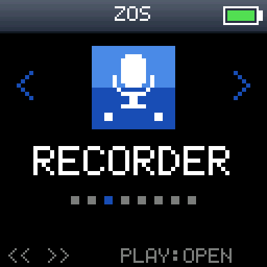
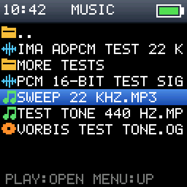
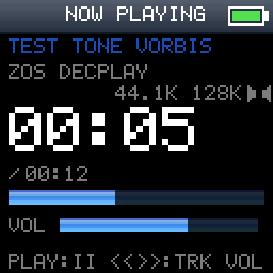
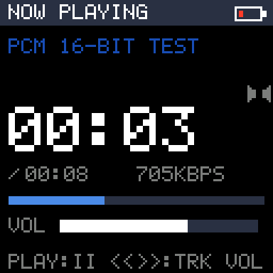
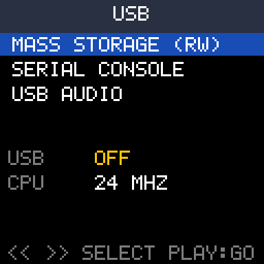
</p>
<p>
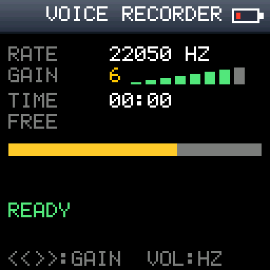
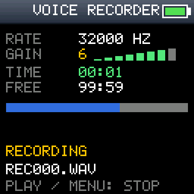
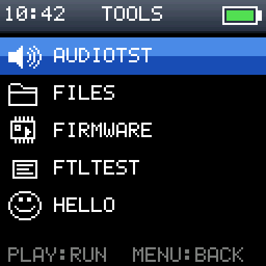
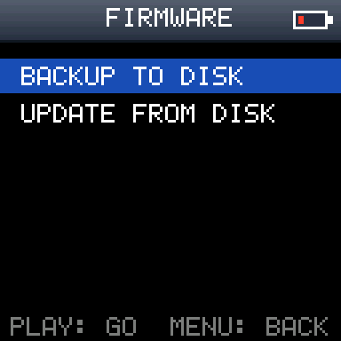
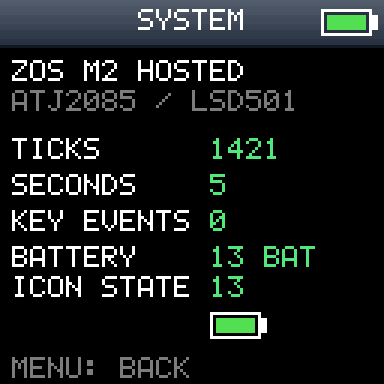
</p>
<p>
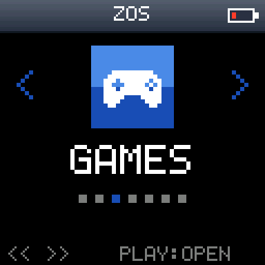
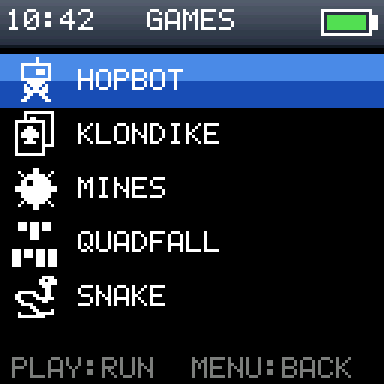
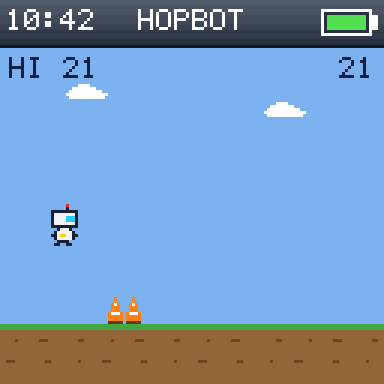

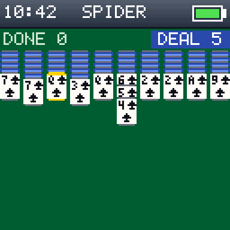
</p>
<p>
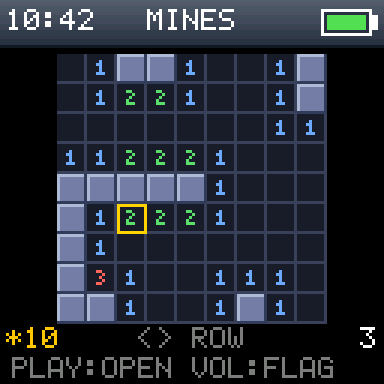
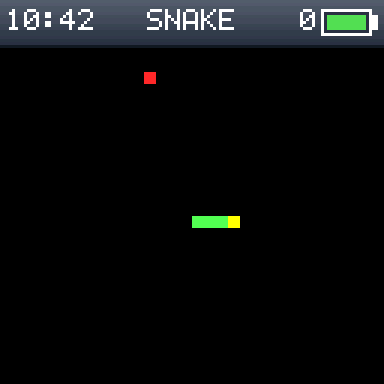
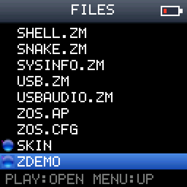
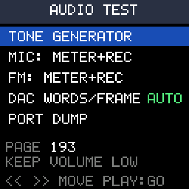
</p>

All screenshots come from the emulator (`zos/tools/emu_nand_zos.py`), scaled 3x. The audio
screens use test tones and the emulator's test models of the DSP programs.

## Supported hardware

* **Tested:** LISONG **LSD_501** board (sold as "Ximpro" MP4), ATJ2085X, 128x128 colour LCD
  (SSD1789A-compatible), 1 GB Samsung NAND, 4 keys (MENU, LEFT, RIGHT, PLAY) + volume, stock firmware
  LSD_501_04 (core 3.5.37).
* **Probably close:** other ATJ2085/ATJ2085X players with the same LCD controller, key wiring and
  "641" NAND FTL. LCD, keys and FM tuner wiring are board-specific (`zos/targets/atj2085/`), so expect
  to adapt them. Other Actions chips (ATJ2091, ATJ2097, ...) are **not** supported.

## Safety: read this first!

* **Back up your player before anything else.** You need a full NAND dump made with **s1clone**
  (`*.s1clone`) and a firmware read-back made with **s1res** (`*.fw`). These are your only way
  back, and you also need both to run the emulator.
* **zos itself writes only the user disk.** zos is started from the USB disk (by the patched
  firmware or a small launcher app). Leaving zos resets the player through the watchdog back into
  the untouched stock firmware. Its NAND write path refuses everything below the user disk. The
  exceptions are in the FIRMWARE module: **UPDATE FROM DISK** (next point) and **BREC UPDATE /
  BREC RESTORE**, which rewrite the boot record only when you pick them and hold `>>` (emulator-
  verified only; a bad boot record needs ROM recovery with s1clone, see
  [tools/brecpatch](tools/brecpatch/README.md)).
* **The FIRMWARE update is emulator-verified only.** It rewrites FWIMAGE copy A (never copy B or
  the boot record) from `UPDATE.FW`, after the same checks the boot record runs at every boot, and
  reads everything back. If the update is interrupted (power loss), the boot record finds copy A
  invalid at the next power-on and restores it from copy B, the old firmware. This was tested in
  the emulator with the real boot record and power cuts at many points
  ([NAND_AND_BOOT.md, section 4](zos/NAND_AND_BOOT.md#4-what-brec-does-with-the-two-fwimage-copies-brec-0x0600-emulator-verified)),
  **not on a device**. Use s1res to flash firmware unless you are prepared to recover through the
  ROM. **BACKUP TO DISK** only reads the firmware area and is device-verified.
* **Flashing a modified firmware (`.fw`) is at your own risk.** The zos patcher, the launcher (ZBOOT
  in place of GAME.AP) and the experimental native-boot firmware all mean writing the FWIMAGE with
  s1res. Use s1res in its normal ADFU mode only. **Never use the GiveIO mode**, which also rewrites
  the boot record.
* **The patcher (`zospatch.py`) is emulator-tested only.** Its boot stub starts stock whenever
  `ZOS.AP` is missing or broken, when MENU or VOL is held at power-on and (on by default) when the
  USB cable is connected at power-on. Test both escapes on your device before you rely on it.
* **Native boot is experimental.** An early native firmware
  read the escape key before setting up the GPIOs, and its core did not match the disk modules.
  The player could only be recovered through the chip's ROM recovery mode and s1clone. The
  current stub escapes to stock when USB power is present at power-on or
  when MENU/VOL is held, and it boots stock by itself if the zos image is damaged. Still: do not
  flash a native firmware whose escape path you have not tested in the emulator, and keep the
  s1clone dump at hand.
* **Recovery mechanism on Native boot:** (1) hold MENU at power-on, or plug in USB, to boot stock, then flash your own
  `.fw` back with s1res. (2) If the device no longer enumerates, use the ATJ2085 boot-ROM recovery
  (ADFU, VID 10D6 PID FF51) with s1clone and your dump.

## Repository layout

| Path | What |
|---|---|
| [`zos/`](zos/README.md) | the OS: `core/` (events, FAT, module loader, API table), `hal/`, `targets/atj2085/` (crt0, ISR, LCD, NAND, registers), `ui/`, `apps/`, `modules/*` (one dir per `.ZM`), `icons/`, `skins/`, `tools/`, `build.py` |
| [`zos/NAND_AND_BOOT.md`](zos/NAND_AND_BOOT.md) | where the firmware lives, NAND map, boot process |
| [`atj2085emu/`](atj2085emu/README.md) | the emulator: Z80 + port model, NAND chip + controller, LCD, keys, DMA, DSP high-level model, USB host model |
| `lisong_rebuild/homebrew/` | homebrew apps that run under the stock OS (launcher, ZBOOT, keytest, snake) with a tiny SDK, and `zkern/` (native-boot firmware builder) |
| [`lisong_rebuild/tools/`](lisong_rebuild/tools/README.md) | firmware/NAND tools: AFI/FWIMAGE pack/unpack, AP/DRV containers, s1clone reader, FTL reader, NAND/firmware injectors for the emulator, Z80 disassembler |
| [`tools/fwpatch/`](tools/fwpatch/README.md) | `zospatch.py`: generic stock-firmware patcher (boot selector stub, offline and emulator tests) |
| [`tools/brecpatch/`](tools/brecpatch/README.md) | `brecpatch.py`: boot-screen patcher for the boot record (fill colour + picture, checksum, preview) |
| `lisong_rebuild/analysis/` | research notes: hardware, NAND/FTL, boot, DSP interface, MP3 driver, DMA/clock, USB, audio, power, I2C/FM, native boot |
| `docs/images/` | screenshots used here |

The directory name `lisong_rebuild` is historical. Only the homebrew, tool and research parts of it
are published (see [NOTICE.md](NOTICE.md)).

## What you need (not included)

This repository contains **no** stock firmware, boot ROM, NAND dump, DSP program, SDK file or
vendor document. You supply them from your own player:

| File (place in the repository root) | How to get it | Used by |
|---|---|---|
| `my-ximpro.fw` | s1res, "read firmware" (AFI image) | `zos/build.py` (extracts `MP3DEC.DSP` and other `.DSP` files), homebrew/zkern firmware builds, emulator |
| `readback-my-ximpro.s1clone` | s1clone, full NAND read (includes the 8 KB boot ROM in its header) | emulator `--nand`, `nandinject.py`, `fwinject.py`, `emu_nand_zos.py` |
| `atj2085emu/rom/comlib.s28` | `python atj2085emu/tools/mkrom.py readback-my-ximpro.s1clone` | emulator (mask-ROM runtime library) |

The scripts use these file names. If yours differ, rename the files or create links, or use
the `--dump` option where a script has one. s1res and s1clone are the community tools from wiRe's
s1mp3 project. Put the player into firmware-upgrade (ADFU) mode the same way the vendor updater does.

## Quick start: run zos in the emulator

Requirements: Windows or Linux, Python 3.10+ (developed with 3.14), and a virtual environment with
the emulator dependencies:

```
python -m venv .venv
.venv/Scripts/pip install z80 numpy pymp3 sounddevice soundfile lameenc pyfatfs fs pyusb
```
(`z80` is the CPU core. `numpy`/`pymp3` are needed for the DSP model's MP3 decode, `sounddevice` for
live audio, `pyfatfs`/`fs` for `mkfatimg.py` and `lameenc` for the test-MP3 generator. On Linux use
`.venv/bin/`.)

1. Put `my-ximpro.fw` and `readback-my-ximpro.s1clone` (your own) in the repository root, then make
   the ROM file: `python atj2085emu/tools/mkrom.py readback-my-ximpro.s1clone`.
2. Check that the stock firmware boots in the emulator:
   ```
   cd atj2085emu
   python headless.py ../my-ximpro.fw --nand ../readback-my-ximpro.s1clone --ticks 320000000 --png menu.png
   ```
   or interactively: `python run_emu.py ../my-ximpro.fw --run`.
3. Build zos (see [Build](#build)), then put the zos files on the dump's user disk as an overlay
   (the dump itself is only read; in PowerShell expand the wildcards yourself, e.g. with `(Get-ChildItem zos/out/atj2085/*.ZM).FullName`):
   ```
   python lisong_rebuild/tools/nandinject.py readback-my-ximpro.s1clone zos.ovl zos/out/atj2085/*.ZM zos/out/atj2085/*.DSP zos/out/atj2085/ZOS.CFG zos/out/atj2085/SKIN
   ```
4. Boot the stock firmware from the dump, inject `ZOS.AP` at the main menu and drive it:
   ```
   python zos/tools/emu_nand_zos.py run1 "430000000:RIGHT:100,442000000:PLAY:100" "480000000:fm.png" --overlay zos.ovl
   ```
   Keys are `T:KEY:ms` (T in absolute T-states, about 12 M per emulated second; keys `MENU LEFT RIGHT PLAY`,
   `USB+`/`USB-`), and shots are `T:file.png`. `run1/run.log` holds the trace.

To boot a patched firmware in the emulator, put it into the dump with
`lisong_rebuild/tools/fwinject.py` and run `tools/fwpatch/test/emu_run.py` (see its header). For the
old native-boot firmware use `lisong_rebuild/homebrew/zkern/emu_native.py`
(see `lisong_rebuild/analysis/zos_native_boot.md`).

Emulator limits: there is no USB host on the device side, the DSP is a high-level model, and
clocks/timing are not modelled. It accepts some things the real hardware rejects. Always confirm
on the device.

## Build

* **SDCC 4.5** (developed with 4.5.10, z80 port). The build scripts expect it in
  `C:\Program Files (x86)\SDCC\` (paths at the top of `zos/build.py`,
  `lisong_rebuild/homebrew/build.py` and `lisong_rebuild/tools/asm_util.py`). On other systems,
  edit those lines.
* **Python 3.10+**, standard library only for the build.

```
python zos/build.py --no-deploy            # -> zos/out/atj2085/ZOS.AP, *.ZM, ZOS.CFG, SKIN/, *.DSP
python zos/build.py --skin ilike           # skin selection (default ilike)
python zos/build.py --drive G:             # build and copy changed files to the player's disk (only if G:\ZOS.AP exists)
```
The build prints the code/RAM use of each image and fails when a limit is exceeded. Unchanged
files come from a cache in `zos/out/cache`. Delete that folder to force a full rebuild.

The DSP programs `MP3DEC.DSP`, `OGGDEC.DSP`, `PCMDEC.DSP` (MP3, Ogg Vorbis and WAV decoders) and
`ADENCM.DSP` (IMA ADPCM encoder for the recorder) are **taken from your firmware** at build
time: `zos/build.py` reads `my-ximpro.fw` from the repository root (`FW_IMAGE` in `build.py`) and
copies them out of its FWIMAGE. Without that file the build still works, but it prints a note and
the players and the recorder cannot work.

The firmware patcher needs its boot stub assembled once (SDCC's `sdasz80`/`sdldz80`):
```
python tools/fwpatch/build_stub.py                                  # -> tools/fwpatch/zosboot.bin
python tools/fwpatch/zospatch.py my-ximpro.fw -o zos-patched.fw     # patch (see tools/fwpatch/README.md)
python tools/fwpatch/zospatch.py --check zos-patched.fw             # show the contents, verify all checksums
python tools/fwpatch/zospatch.py --unpatch zos-patched.fw -o stock.fw   # byte-identical original
```

Homebrew apps for the stock OS (run under ACTOS, built into a copy of your firmware):
```
python lisong_rebuild/homebrew/build.py zboot --as GAME.AP --fw   # -> lisong_rebuild/build_v04/homebrew-zboot-v04.fw
python lisong_rebuild/homebrew/build.py launcher --fw              # generic *.AP launcher instead
python lisong_rebuild/homebrew/zkern/build.py --build-zos          # experimental native boot -> build_v04/zos-native-v04.fw
```

## Install on a device

zos always runs from files on the player's USB disk. Copy these from `zos/out/atj2085/` to the root
of the disk: `ZOS.AP`, `*.ZM`, `*.DSP`, `ZOS.CFG` and the `SKIN` folder (`zos/build.py --drive X:`
does this for later updates). There are two ways to start it; both need one firmware write with
**s1res, write firmware (normal mode, not GiveIO)**. Back up the player first (see
[Safety](#safety-read-this-first)).

**Patched firmware (preferred; emulator-tested, not yet tested on a device).**
[`zospatch.py`](tools/fwpatch/README.md) turns your own stock `.fw` into one that:

* boots the unchanged stock firmware by default (all stock files stay byte for byte, the stock
  kernel is kept as `SYSCFG.STK`);
* starts zos only when an intact `ZOS.AP` is in the disk root. Delete or rename `ZOS.AP` (in the
  stock USB disk mode) to go back to stock without reflashing;
* starts stock when MENU or VOL is held at power-on, and (unless `--no-vbus-escape`) when the USB
  cable is connected at power-on, so the stock USB disk and s1res always stay reachable;
* refuses firmware it does not fully understand (checksums, boot record loader/reader) and checks
  its own output, including a byte-identical `--unpatch`.

Boot records other than the known "F641" one always boot stock. Read
[tools/fwpatch/README.md](tools/fwpatch/README.md) (limitations included) before you flash, and
test both escapes on your player first.

**Launcher (device-tested).** `homebrew-zboot-v04.fw` (see [Build](#build)) is your own firmware with
GAME.AP ("JUEGOS"/Games in the stock menu) replaced by ZBOOT, a loader for `ZOS.AP`. Every other
stock app is unchanged. Open Games in the stock menu and zos starts.

With either: REBOOT on the carousel, or any crash, returns to the stock firmware through a
watchdog reset. To undo: write your original `my-ximpro.fw` with s1res (or the output of
`zospatch.py --unpatch`).

**Native boot (old, experimental, see the warnings above).** `zkern/build.py` produces a firmware in
which the boot record starts a zos core stored in the firmware, with the stock kernel kept as
`SYSCFG.STK`. The patcher replaces it: it loads the core from the disk, so the core always matches
the modules next to it. Read `lisong_rebuild/analysis/zos_native_boot.md` completely before you try it.

## Documentation

* [zos design, memory map, modules](zos/README.md) · [firmware location, NAND map, boot](zos/NAND_AND_BOOT.md) ·
  [icons](zos/icons/README.md) · [skins](zos/skins/ilike/README.md)
* [Firmware patcher](tools/fwpatch/README.md) · [Emulator](atj2085emu/README.md) · [firmware/NAND tools](lisong_rebuild/tools/README.md) ·
  [homebrew apps under the stock OS](lisong_rebuild/homebrew/README.md)
* Research notes in `lisong_rebuild/analysis/`:
  [hardware reference](lisong_rebuild/analysis/atj2085_hw.md),
  [NAND + FTL](lisong_rebuild/analysis/nand_ftl.md), [boot](lisong_rebuild/analysis/boot.md),
  [DSP interface](lisong_rebuild/analysis/dsp_interface.md), [MP3 driver](lisong_rebuild/analysis/mp3_driver_spec.md),
  [DMA and clocks](lisong_rebuild/analysis/dma_clock.md), [audio](lisong_rebuild/analysis/audio_hw.md),
  [power](lisong_rebuild/analysis/power.md), [I2C/FM](lisong_rebuild/analysis/i2c.md),
  [USB MSC](lisong_rebuild/analysis/usb_msc.md), [zos USB](lisong_rebuild/analysis/zos_usb.md),
  [native boot](lisong_rebuild/analysis/zos_native_boot.md), [OGG/recording/RDS](lisong_rebuild/analysis/ogg_rec_rds.md),
  [FLAC feasibility](lisong_rebuild/analysis/dsp_flac.md)

Some research notes cite file paths from the author's work tree (stock disassembly, SDK folders,
vendor PDFs). Those files are **not** part of this repository.

## License

MIT, see [LICENSE](LICENSE). Third-party material and what is deliberately not included:
[NOTICE.md](NOTICE.md).
